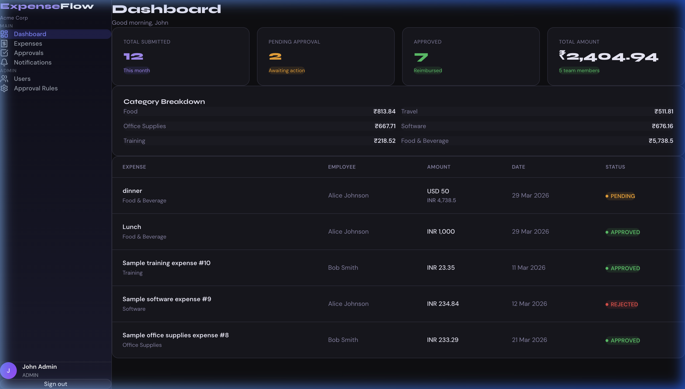
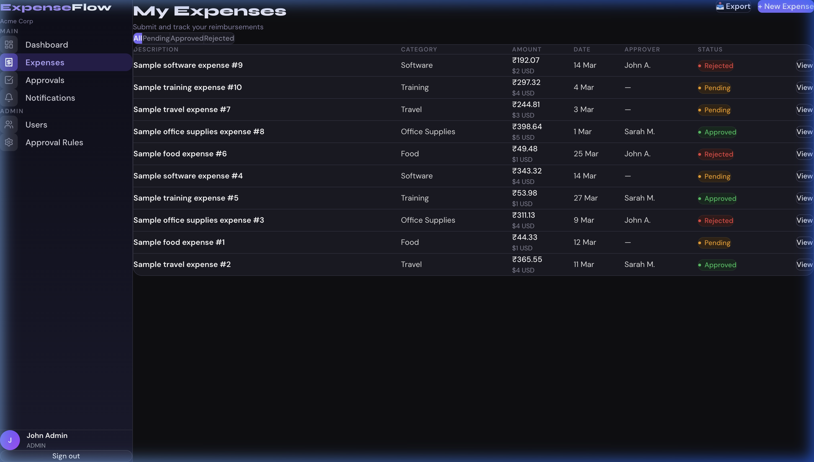
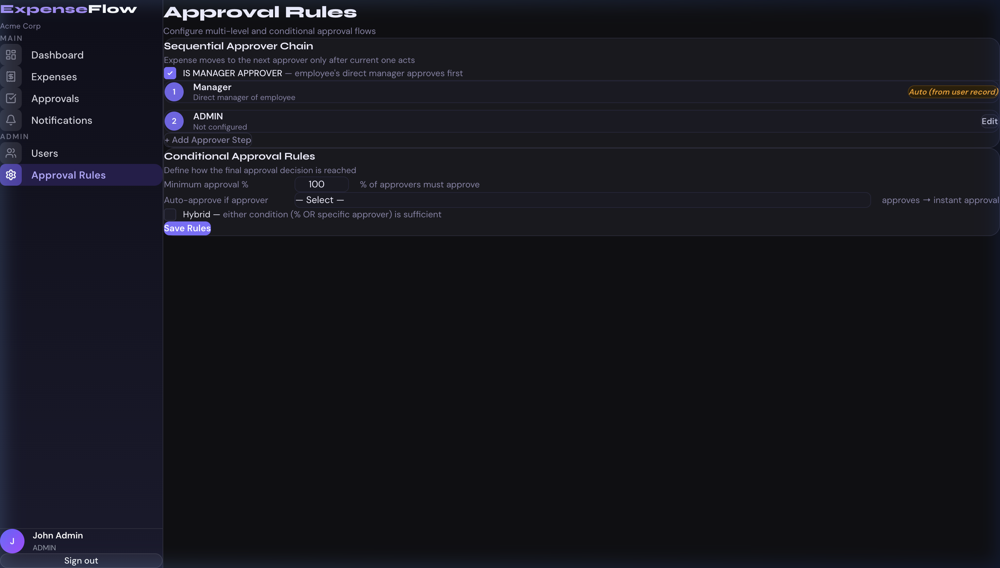
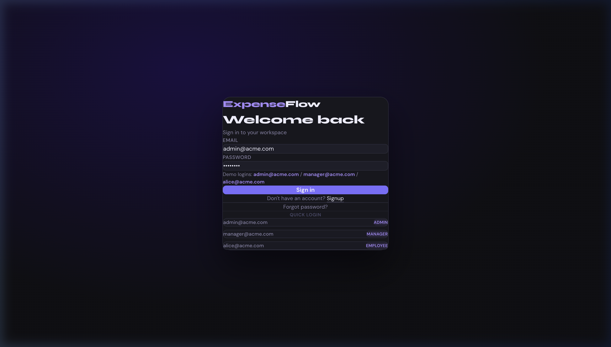

<div align="center">

# 💸 ExpenseFlow

### A Premium Reimbursement Management System


[](https://react.dev/)
[](https://nodejs.org/)
[](https://www.prisma.io/)
[](https://vitejs.dev/)
[](https://tailwindcss.com/)
[](LICENSE)

*A full-stack, production-ready expense reimbursement platform with multi-level approvals, OCR receipt scanning, role-based access control, and a premium dark UI.*

</div>

---

## ✨ About

**ExpenseFlow** is a comprehensive employee reimbursement platform designed for modern teams. It streamlines the entire expense lifecycle — from submission to multi-step approval — with a beautiful, responsive dark-themed interface.

Built for companies that need:
- 📋 **Structured expense workflows** with configurable multi-level approval chains
- 🔒 **Role-based access control** — Admins, Managers, and Employees each have distinct permissions
- 🤖 **Smart automation** — OCR auto-extracts data from receipt images, reducing manual entry
- 💱 **Multi-currency support** — Auto-converts expenses using live exchange rates (INR default)
- 📊 **Real-time analytics** — Role-specific dashboards with expense summaries and trends

---

## 🚀 Tech Stack

| Layer | Technology |
|---|---|
| **Frontend** | React 19, Vite 5, Tailwind CSS v4 |
| **Backend** | Node.js, Express 4 |
| **Database** | SQLite via Prisma ORM (PostgreSQL-ready) |
| **Auth** | JWT (bcryptjs + jsonwebtoken) |
| **OCR** | Tesseract.js |
| **Email** | Nodemailer + Ethereal Email (dev) |
| **Currency** | ExchangeRate-API |
| **Fonts** | DM Sans + Syne (Google Fonts) |

---

## 🎯 Key Features

- 🔐 **Authentication & RBAC** — Secure JWT login with role-based route protection
- 🏢 **Company Auto-Setup** — Signup auto-creates a company with country-based default currency
- 📁 **Expense Management** — Submit, track, filter, and export expenses with receipt uploads
- 🤖 **OCR Receipt Parsing** — Auto-extract amount, date, and vendor from receipt photos
- 🔗 **Multi-Level Approvals** — Sequential approval chains (Manager → Finance → Director)
- ⚙️ **Conditional Rules** — Percentage-based, specific-approver, and hybrid approval logic
- 🛡️ **Admin Override** — Force approve or reject any pending expense
- 🔔 **Notifications** — In-app real-time notifications for approvals and rejections
- 📈 **Analytics Dashboard** — Spending summaries, trends, pending counts per role
- 📤 **CSV Export** — Download filtered expense reports
- 🔑 **Forgot Password** — Auto-generates and emails a new password (Nodemailer)
- 📱 **Responsive UI** — Premium dark theme, works across all screen sizes

---

## 🖥️ Screenshots

<div align="center">
  
</div>

<div align="center">
  
</div>

<div align="center">
  
</div>

<div align="center">
  
</div>

The UI features a custom dark design system with:
- `#0f0f13` page background
- `DM Sans` body font + `Syne` heading font
- Accent color `#7c6fff` (purple)
- Glassmorphism-inspired card surfaces

---

## ⚡ Quick Start

### Prerequisites
- Node.js 18+
- npm 9+

### Setup

```bash
# Clone the repository
git clone https://github.com/nakuldagade/Reimbursement_management.git
cd Reimbursement_management
```

#### Backend
```bash
cd server
npm install

# Configure environment
cp .env.example .env   # then edit with your values

# Set up database
npx prisma db push
node prisma/seed.js

# Start server (port 5001)
npm run dev
```

#### Frontend
```bash
cd ../client
npm install

# Start dev server (port 5173)
npm run dev
```

Open **http://localhost:5173** in your browser.

---

## 🔑 Demo Accounts

| Role | Email | Password |
|------|-------|----------|
| 👑 Admin | admin@acme.com | admin123 |
| 👔 Manager | manager@acme.com | manager123 |
| 👤 Employee | alice@acme.com | employee123 |

---

## 🔌 API Reference

| Method | Endpoint | Description |
|--------|----------|-------------|
| `POST` | `/api/auth/signup` | Register + create company |
| `POST` | `/api/auth/login` | Login → JWT token |
| `POST` | `/api/auth/forgot-password` | Reset password via email |
| `GET` | `/api/auth/me` | Current user profile |
| `GET/POST/PUT/DELETE` | `/api/users` | User management (Admin) |
| `POST` | `/api/expenses` | Submit new expense |
| `GET` | `/api/expenses` | My expenses |
| `GET` | `/api/expenses/all` | All company expenses (Admin) |
| `GET` | `/api/expenses/export` | CSV export |
| `GET` | `/api/approvals/pending` | Pending approvals queue |
| `POST` | `/api/approvals/:id/approve` | Approve an expense |
| `POST` | `/api/approvals/:id/reject` | Reject an expense |
| `POST` | `/api/approvals/:id/override` | Admin force override |
| `GET/POST` | `/api/approvals/chain` | Approval chain config |
| `GET/POST/PUT/DELETE` | `/api/rules` | Conditional rules |
| `GET` | `/api/notifications` | In-app notifications |
| `GET` | `/api/dashboard/stats` | Dashboard statistics |
| `POST` | `/api/ocr/parse` | OCR receipt parsing |

---

## 📁 Project Structure

```
Reimbursement_management/
├── server/
│   ├── prisma/
│   │   ├── schema.prisma       # Database schema
│   │   ├── seed.js             # Demo data seeder
│   │   └── migrations/         # Migration files
│   └── src/
│       ├── config/             # Prisma client
│       ├── middleware/         # Auth, RBAC, upload, error handler
│       ├── routes/             # All API route handlers
│       └── utils/              # OCR, currency, countries
│
└── client/
    └── src/
        ├── components/         # Layout, NotificationBell, StatusBadge
        ├── context/            # AuthContext (global user state)
        ├── pages/              # Dashboard, Expenses, Approvals, Rules...
        └── services/           # Axios API client
```

---

## 🛠️ Environment Variables

Create `server/.env`:

```env
DATABASE_URL="file:./dev.db"
JWT_SECRET="your-super-secret-key"
JWT_EXPIRES_IN="7d"
PORT=5001

# Optional: Real email sending (if omitted, uses Ethereal mock)
SMTP_HOST="smtp.gmail.com"
SMTP_PORT=587
SMTP_USER="your-email@gmail.com"
SMTP_PASS="your-gmail-app-password"
```

---

## 📄 License

MIT © [Nakul Dagade](https://github.com/nakuldagade)
